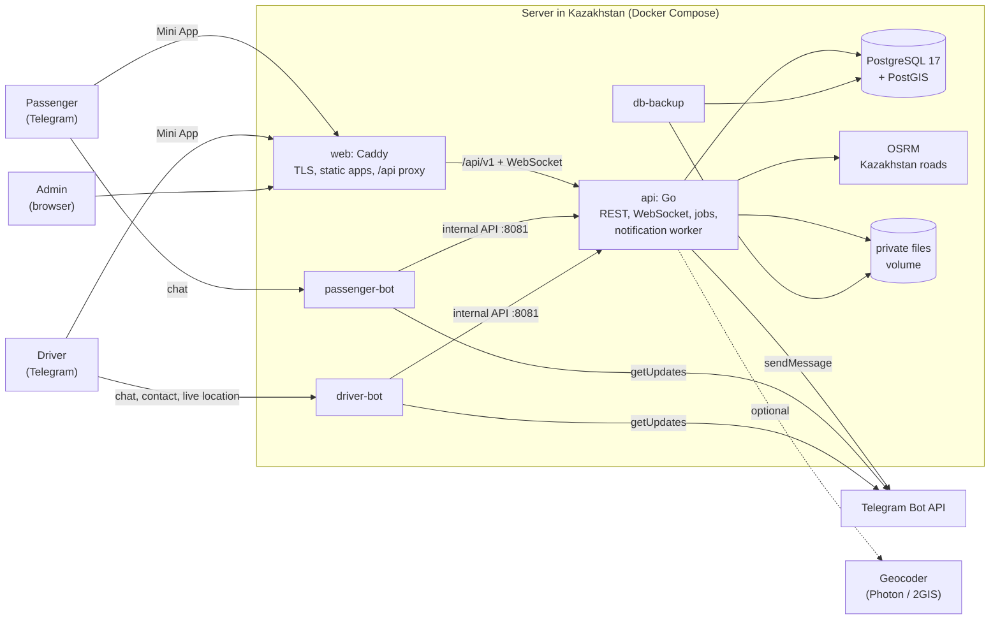

# Jan Taxi

Jan Taxi is a taxi and parcel-delivery service for Kazakhstan that runs inside
Telegram. Passengers order rides and deliveries in a Telegram Mini App, drivers
register, go online, accept orders and navigate with 2GIS from a second Mini App,
and operators run the service from a web admin panel. The first city is Embi
(Aktobe region); orders and driver locations are accepted anywhere inside
Kazakhstan and rejected outside it.

The binding engineering contract is [docs/ARCHITECTURE.md](docs/ARCHITECTURE.md);
the HTTP contract is [admin/backend/api/openapi.yaml](admin/backend/api/openapi.yaml)
(also served at `/api/v1/openapi.yaml`).

## How the service works

- **Passengers** open the passenger bot, then the Mini App. They choose *Taxi*,
  *Parcel* or *Other delivery*, set 2 to 5 route points (pickup, up to three
  intermediate stops, destination) on the map, see the route, distance and the
  allowed fare range calculated by the server, pick a fare and order. They pay the
  driver directly, in cash or by bank transfer; the platform does not take
  passenger payments.
- **Drivers** register in the driver Mini App: name, vehicle and plate, ID card
  photos, vehicle photos and a phone number verified through Telegram. An admin
  approves the application, asks for corrections or rejects it. Approved drivers go
  online, see open orders in their city and accept them; exactly one driver wins an
  order. During the trip they mark arrival, start, every intermediate stop and
  completion, and open turn-by-turn navigation in 2GIS.
- **Commission**: the platform charges 10% of the fare (configurable per tariff,
  integer tenge, rounded half up) from the driver's prepaid wallet. The amount is
  reserved when the driver accepts, charged once when the trip is completed and
  released if the order is cancelled. Drivers top up the wallet through Kaspi Pay;
  a finance admin credits the money only after checking the payment in the
  merchant's Kaspi Pay records. There is no automatic Kaspi confirmation: Kaspi
  documents no public API or webhook for confirming such payments.
- **Admins** moderate drivers, follow and manage orders and disputes, verify
  top-ups, adjust wallets, edit cities, zones, tariffs and settings, and review the
  audit log. Access is role-based (super admin, operator, driver moderator,
  finance manager, auditor).
- **Notifications** reach users through the two bots (transactional outbox with
  retries); the apps update live over a WebSocket.

The interface is Kazakh by default, with Russian and English.

## Repository layout

```
passenger/                 everything a passenger touches
  bot/                     passenger Telegram bot (Go, long polling)
  miniapp/                 passenger Mini App (Vue 3 + TypeScript + MapLibre)
driver/                    everything a driver touches
  bot/                     driver Telegram bot (Go)
  miniapp/                 driver Mini App (Vue 3 + TypeScript + MapLibre)
admin/                     the platform core
  backend/                 central Go API, migrations, OpenAPI contract
    cmd/api                api serve | migrate up|status | admin create | healthcheck
    cmd/devlink            signed local Mini App links (development only)
    internal/...           domain packages (orders, dispatch, wallets, ...)
    pkg/                   public client packages used by the bots
    migrations/            goose SQL migrations (embedded)
  frontend/                admin panel (Vue 3 + TypeScript)
deploy/                    backup/restore, OSRM, Photon, preflight, dev env
docs/                      architecture, deployment, operations, diagrams
compose.yaml, Dockerfile.*, Caddyfile, Makefile, .env.example
```

One Go module (`github.com/yereke99/jantaxi`) and one pnpm workspace cover all
three directories.

## Architecture



- Only the API talks to PostgreSQL. The bots call the API's internal listener
  (`:8081`, never published) with a shared service secret.
- Mini Apps authenticate with Telegram-signed `initData`, validated with the
  matching bot token; the admin panel uses an HttpOnly cookie session with CSRF
  protection.
- Order transitions, wallet entries, notifications and realtime events are
  written in one database transaction; realtime events use `pg_notify`, so they
  are delivered only after commit.
- More diagrams (booking flow, moderation, navigation, order states, money flow,
  outbox, deployment): [docs/DIAGRAMS.md](docs/DIAGRAMS.md). A Kazakh overview for
  the customer: [docs/CUSTOMER_OVERVIEW_KK.md](docs/CUSTOMER_OVERVIEW_KK.md).

## Quick start (local development)

Requirements: Go 1.26, Node.js 24 with pnpm 10 (`corepack enable`), Docker.
No Telegram account or real bot is needed to work on the API and the Mini Apps.

```sh
make test-db-up                                  # PostGIS on localhost:55432
cp deploy/dev/dev.env.example .env.dev           # development settings
make dev-api                                     # API on :8080 (+ internal :8081), migrates on start
```

In other terminals:

```sh
make fe-install
make fe-dev APP=passenger                        # http://localhost:5173/passenger/
make fe-dev APP=driver                           # http://localhost:5174/driver/
make fe-dev APP=admin                            # http://localhost:5175/
make devlink APP=passenger START=taxi            # prints a signed Mini App URL
make devlink APP=driver TG_ID=100000002          # a different Telegram user
```

Open the printed URL in a desktop browser: it carries `initData` signed with the
development bot token from `.env.dev`, exactly as Telegram would pass it, and the
API accepts it. The Vite dev servers proxy `/api` (including the WebSocket) to
`localhost:8080`.

Create an admin for the admin panel (the password is read from the terminal):

```sh
set -a; . ./.env.dev; set +a
go run ./admin/backend/cmd/api admin create --email you@example.com --role super_admin --name "Dev Admin"
```

**Routing.** Route previews need an OSRM router. Build the Kazakhstan dataset
once (downloads about 215 MB and needs about 6 GB of RAM for a few tens of
minutes), then serve it on `localhost:5000`:

```sh
make osrm-prepare ENV_FILE=.env.example
make dev-osrm
```

**Bots.** The bots need real bots from @BotFather (create separate test bots).
Put their tokens and usernames into `.env.dev`, set
`NOTIFICATION_WORKER_ENABLED=true`, restart `make dev-api` and run `make dev-bots`.
Telegram opens Mini Apps only over HTTPS, so testing inside Telegram needs a
public HTTPS URL for the Mini Apps (see [docs/TELEGRAM_SETUP.md](docs/TELEGRAM_SETUP.md)).

**Whole stack in Docker on a laptop.** See `compose.override.example.yaml` (plain
HTTP on `localhost:8088` / `localhost:8089`).

## Production deployment

Summary (details in [docs/DEPLOYMENT.md](docs/DEPLOYMENT.md)):

1. A Docker host **located in Kazakhstan** (personal-data localisation), 4 vCPU /
   8 GB RAM / 80 GB SSD or more, ports 80 and 443 open.
2. DNS: two names (`APP_DOMAIN` for the Mini Apps and API, `ADMIN_DOMAIN` for the
   admin panel) pointing at the server.
3. `cp .env.example .env`, fill in every required value, `make preflight`.
4. `make build && make osrm-prepare && make up && make health`.
5. `make admin-create EMAIL=... ROLE=super_admin NAME="..."`.
6. Configure both bots in @BotFather ([docs/TELEGRAM_SETUP.md](docs/TELEGRAM_SETUP.md)),
   then the Kaspi Pay details, tariffs and support contacts in the admin panel.
7. Set up an off-site copy of `./backups` and run a restore drill
   ([docs/OPERATIONS.md](docs/OPERATIONS.md)).

Services: `db` (PostGIS), `migrate` (one-shot), `api`, `passenger-bot`,
`driver-bot`, `web` (Caddy; the only service with published ports), `db-backup`
(nightly `pg_dump` and file archive, 14-day retention) and, by profile, `osrm`,
`osrm-prepare`, `photon`.

## Configuration

All configuration is environment variables; [.env.example](.env.example) lists and
explains every one. `compose.yaml` passes the API's variables to the container
explicitly (`x-api-env`), so `docker compose --env-file <file>` uses one file for
everything; a new API variable must be added there and to `.env.example`. The
most important:

| Variable | Purpose |
|---|---|
| `APP_ENV` | `production` (strict validation) or `development` |
| `APP_DOMAIN`, `ADMIN_DOMAIN`, `ACME_EMAIL` | Caddy site names and certificate contact |
| `POSTGRES_USER`, `POSTGRES_PASSWORD`, `POSTGRES_DB` | Database; compose builds `DATABASE_URL` from them |
| `PASSENGER_BOT_TOKEN`, `DRIVER_BOT_TOKEN` | Two different bots from @BotFather |
| `PASSENGER_BOT_USERNAME`, `DRIVER_BOT_USERNAME` | Bot usernames (links, deep links) |
| `PASSENGER_MINIAPP_URL`, `DRIVER_MINIAPP_URL` | `https://APP_DOMAIN/passenger/`, `https://APP_DOMAIN/driver/` |
| `ADMIN_FRONTEND_URL`, `API_PUBLIC_URL` | `https://ADMIN_DOMAIN/`, `https://APP_DOMAIN` |
| `SESSION_SECRET`, `INTERNAL_BOT_SERVICE_SECRET` | 32+ byte secrets, different from each other |
| `KASPI_PAY_PAYMENT_URL`, `KASPI_PAY_RECIPIENT_NAME`, `KASPI_PAY_PAYMENT_INSTRUCTIONS` | Payment details shown to drivers for top-ups (also editable in the admin panel) |
| `MAP_STYLE_URL`, `MAP_CONNECT_SRC` | Map style for the Mini Apps and the matching CSP origins |
| `OSRM_BASE_URL` | Router (default `http://osrm:5000`) |
| `GEOCODING_PROVIDER`, `GEOCODING_BASE_URL`, `GEOCODING_API_KEY` | `photon`, `nominatim`, `twogis` or `none` |
| `TWOGIS_BASE_URL` | Base of 2GIS navigation links |
| `DEFAULT_CITY`, `DEFAULT_LANGUAGE`, `MAX_ROUTE_POINTS`, `DEFAULT_COMMISSION_PERCENT` | `EMB`, `kk`, `5`, `10` |
| `BACKUP_RETENTION_DAYS`, `BACKUP_TIME`, `BACKUP_OWNER` | Nightly backup schedule, retention and file owner |
| `LOG_LEVEL`, `LOG_FORMAT` | `info`/`json` in production |

Runtime-editable settings (support contacts, Kaspi details, top-up limits,
prohibited items, minimum online balance and others) live in the database and are
changed in the admin panel; secrets never do.

## Testing

```sh
make test-db-up && make test     # Go unit + PostgreSQL integration tests, -race
make lint                        # go vet, gofmt, vue-tsc
make fe-test                     # vitest for all three apps
make verify-shared               # shared Mini App core identical in both apps
make openapi-lint                # contract lint + "every route is documented"
make config ENV_FILE=.env.example   # compose.yaml validates against the template
make caddy-validate              # Caddyfile validation (needs Docker)
```

What the suites cover, including the concurrency and money tests:
[docs/TESTING.md](docs/TESTING.md).

## Security notes

- Mini App sign-in validates Telegram `initData` with HMAC-SHA256 against the bot
  that launched the app (24 h maximum age); app tokens are short-lived (12 h),
  signed with `SESSION_SECRET` and re-checked against the user's blocked status.
- Admin sessions: argon2id passwords, HttpOnly + Secure + SameSite=Strict cookie,
  CSRF header on every write, login rate limits and lockout, role-based
  permissions enforced on the server, audit log of admin actions.
- Driver ID photos are private: never served statically, re-encoded (EXIF and GPS
  removed), visible only to roles with `documents.view`, and every view is
  audit-logged.
- Secrets live only in `.env` (mode 600) and are redacted from logs; bot tokens are
  scrubbed even from error messages. Caddy access logs drop search text and
  coordinates from query strings.
- The database and the API's internal listener are on an internal Docker network;
  only Caddy publishes ports. The Go services run as non-root on a read-only
  root filesystem with all Linux capabilities dropped.
- Money is integer tenge, every wallet change is an append-only ledger row with a
  unique idempotency key, and a reconciliation check compares wallets with the
  ledger.
- Personal-data duties under the Law of the Republic of Kazakhstan No. 94-V:
  [docs/DATA_PROTECTION.md](docs/DATA_PROTECTION.md).

## External dependencies and missing credentials

The code does not contain, and cannot create, the following. The service will not
work in production until the owner provides them.

| Needed | Who / where | Used for |
|---|---|---|
| Two Telegram bots (tokens and usernames) | @BotFather, by the owner's Telegram account | Passenger and driver bots, Mini App sign-in, notifications |
| Main Mini App configured for each bot (URL on `APP_DOMAIN`) | @BotFather → Bot Settings → Configure Mini App | Opening the Mini Apps from bots and `t.me` links |
| Domain with two DNS names and HTTPS | Domain registrar / DNS provider; certificates are issued automatically by Caddy | Mini Apps (Telegram requires HTTPS), admin panel |
| Server hosted in Kazakhstan | A hosting provider whose data centre is in Kazakhstan, confirmed in the contract | Law 94-V localisation of personal data |
| Kaspi Pay merchant account (ИП or ТОО), its payment link and recipient name | Kaspi Pay for business | Driver wallet top-ups |
| Access to Kaspi Pay payment history and XLSX reports for finance staff | Kaspi Pay app / web cabinet | Manual verification and monthly reconciliation of top-ups |
| OpenStreetMap extract for Kazakhstan | Geofabrik (downloaded by `make osrm-prepare`; ODbL attribution) | Self-hosted OSRM routing |
| Geocoder decision | Public Photon (fair use only), self-hosted Photon (`make geocoder-import`), or a 2GIS API key | Address search and reverse geocoding |
| Second storage location in Kazakhstan | Hosting provider | Off-site copies of `./backups` |
| Legal and data-protection documents | Owner with a lawyer | Privacy policy, consent texts with the operator's name and BIN, responsible person, breach procedure, taxi dispatch-service obligations (akimat notification register, contracts with carriers) |
| Support contacts | Owner | Shown in bots and Mini Apps (admin panel settings) |

Attribution required by data licences: map tiles © OpenMapTiles, data ©
OpenStreetMap contributors (shown by the map), routing data © OpenStreetMap
contributors (ODbL); the Kazakhstan boundary is Natural Earth (public domain).
# jan-taxi
