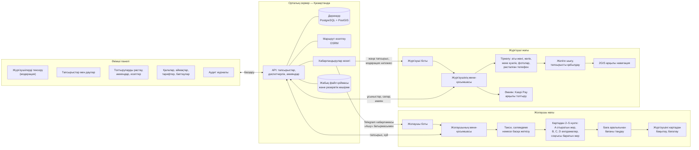
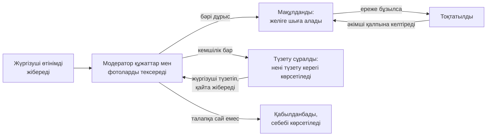
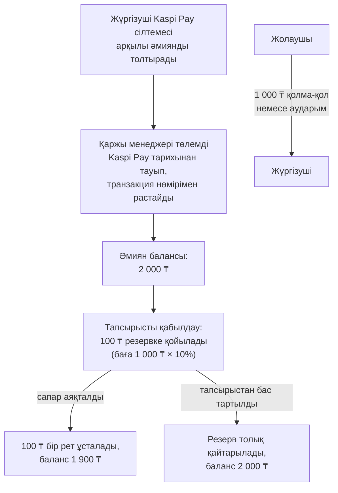
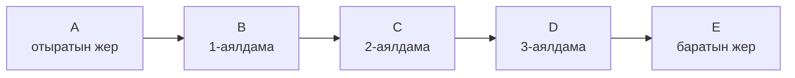
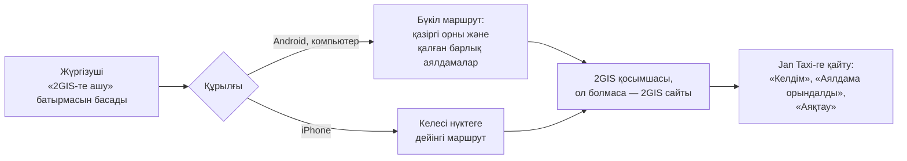

# Jan Taxi — жүйеге шолу

Jan Taxi — Telegram ішінде жұмыс істейтін такси және сәлемдеме жеткізу қызметі.
Жолаушылар мен жүргізушілер жеке қосымша орнатпайды: бәрі Telegram боттары мен
мини-қосымшалары арқылы жүреді, ал қызметті әкімшілер веб-панельден басқарады.
Бірінші қала — Ембі (Ақтөбе облысы). Тапсырыс Қазақстанның кез келген нүктесінде
қабылданады, Қазақстаннан тыс нүктелер қабылданбайды.

Қосымшалардың негізгі тілі — қазақ тілі; орыс және ағылшын тілдері де бар.

## Жалпы сызба

## Жолаушы

- Жолаушы ботты ашып, «Ашу» батырмасы арқылы мини-қосымшаға кіреді.
- Қызмет түрін таңдайды: **Такси**, **Сәлемдеме** немесе **Басқа жеткізу**.
  Сәлемдеме үшін жүктің қысқаша сипаттамасы, алушының телефон нөмірі және
  тыйым салынған заттар тізімімен келісу міндетті.
- Картадан 2–5 нүкте белгілейді: отыратын жер, ең көбі үш аралық аялдама және
  баратын жер.
- Сервер маршрутты, қашықтықты, жол уақытын және рұқсат етілген баға аралығын
  есептейді. Жолаушы бағаны осы аралықтан таңдайды.
- Жүргізуші табылғанда жолаушы оның атын, көліктің маркасын, түсін және
  мемлекеттік нөмірін көреді, жүргізушінің жақындап келе жатқанын картадан
  бақылайды.
- Сапар ақысын жүргізушіге **тікелей** төлейді: қолма-қол немесе банк
  аударымымен. Платформа жолаушыдан ақша алмайды.
- Сапардан кейін жүргізушіні бағалай алады.

## Жүргізуші

- Жүргізуші ботынан ашылатын мини-қосымшада тіркеледі: аты-жөні, көлік
  (маркасы, моделі, түсі, мемлекеттік нөмірі), жеке куәліктің екі жағының
  фотосы, өз фотосы, көліктің фотолары және Telegram арқылы расталған телефон
  нөмірі.
- Дербес деректерді өңдеуге келісім береді, содан кейін өтінім модераторға
  жіберіледі.
- Мақұлданғаннан кейін «Желіде» қосқышын қосып, өз қаласындағы тапсырыстарды
  көреді.
- Бір тапсырысты тек бір жүргізуші ала алады: екі жүргізуші бір мезетте басса,
  біріншісі ғана қабылдайды, екіншісіне «тапсырысты басқа жүргізуші алды» деп
  хабарланады.
- Сапар кезінде: «Келдім», «Сапарды бастау», әр аялдаманы белгілеу және
  «Аяқтау».

## Жүргізушіні тексеру (модерация)

Әр шешім туралы жүргізушіге бот арқылы хабарлама келеді. Жеке куәліктің
фотоларын тек рұқсаты бар модераторлар көреді, әр қарау аудит журналына
жазылады.

## Әкімші панелі

Әкімші панелі — браузерде ашылатын жеке сайт. Онда:

- жүргізушілерді тексеру, тоқтату және қалпына келтіру;
- тапсырыстарды бақылау, қажет болса болдырмау немесе жүргізушіге тағайындау;
- дауларды шешу;
- әмиянды толтыру өтінімдерін растау немесе қабылдамау, әмияндарды түзету;
- қалалар, қызмет аймақтары, тарифтер, қолдау байланыстары және басқа
  баптаулар;
- хабарландырулар, есептер (CSV) және аудит журналы.

Әр әкімшінің рөлі бар: супер-әкімші, оператор, жүргізуші модераторы, қаржы
менеджері және аудитор. Әр рөл тек өзіне рұқсат етілген бөлімдерді көреді.

## Төлем және 10% комиссия

- Комиссия — сапар бағасының **10%-ы** (тарифте өзгертуге болады), бүтін теңгемен
  есептеледі, жартысы жоғары қарай дөңгелектенеді.
- Жолаушы бүкіл соманы жүргізушіге тікелей төлейді; платформаның үлесі
  жүргізушінің алдын ала толтырылған әмиянынан ұсталады.
- Тапсырысты қабылдау үшін әмиянда комиссияға жететін бос қаражат болуы керек.
- Тапсырыстан сапар аяқталғанға дейін бас тартылса, резервке қойылған сома
  толық қайтарылады.
- Әмиянды толтыру: жүргізуші Kaspi Pay сілтемесі арқылы төлейді және төлем
  хатына толтыру кодын жазады (мысалы, `EMB001-TOPUP-000123`). Kaspi мұндай
  төлемдерді автоматты түрде растауға арналған ашық API жарияламаған, сондықтан
  баланс қаржы менеджері төлемді Kaspi Pay жазбаларынан тауып, Kaspi транзакция
  нөмірімен растағаннан кейін ғана толтырылады. Бір Kaspi транзакциясы екі рет
  есептелмейді.
- Әр ақша қозғалысы өзгертуге және жоюға болмайтын журналға жазылады;
  әкімшілер әмиян мен журналдың сәйкестігін тексере алады.

## Бірнеше аялдамалы маршрут

- Бір тапсырыста 2–5 нүкте болады; әріптер картада да, тізімде де бірдей.
- Маршрут Қазақстан жолдары бойынша есептеледі (OSRM, OpenStreetMap деректері),
  баға бүкіл маршрутқа есептеледі.
- Жүргізуші аралық аялдамаларды тек ретімен белгілейді; барлық аялдама
  орындалмай тапсырысты аяқтау мүмкін емес.

## 2GIS арқылы навигация

Маршрут Jan Taxi картасында да әрдайым көрініп тұрады, сондықтан жүргізуші
келесі аялдаманы адастырмайды.

## Деректер және қауіпсіздік

- Барлық деректер, файлдар және резервтік көшірмелер Қазақстандағы серверде
  сақталады (ҚР «Дербес деректер және оларды қорғау туралы» заңы).
- Жеке куәлік фотолары жабық қоймада сақталады, тек рұқсаты бар модераторлар
  көреді, әр қарау журналға жазылады.
- Жүргізуші жолаушының байланыс деректерін және алушының телефонын тек
  тапсырысты қабылдағаннан кейін көреді; жолаушы жүргізушінің телефонын тек
  тапсырыс белсенді кезде көреді.
- Дерекқордың және файлдардың резервтік көшірмесі күн сайын автоматты түрде
  жасалады.

## Іске қосу үшін тапсырыс берушіден не керек

- Telegram-да екі бот (жолаушы және жүргізуші) және олардың баптаулары.
- Домен және Қазақстандағы сервер.
- Kaspi Pay бизнес-шоты, төлем сілтемесі және қаржы менеджеріне Kaspi Pay
  тарихына қолжетімділік.
- Дербес деректер бойынша құжаттар: құпиялылық саясаты, келісім мәтіні,
  жауапты тұлға.
- Қолдау қызметінің байланыстары (телефон, Telegram).

Техникалық толық сипаттама: [ARCHITECTURE.md](ARCHITECTURE.md), сызбалар:
[DIAGRAMS.md](DIAGRAMS.md), орнату: [DEPLOYMENT.md](DEPLOYMENT.md).
