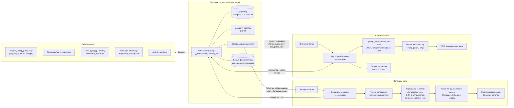
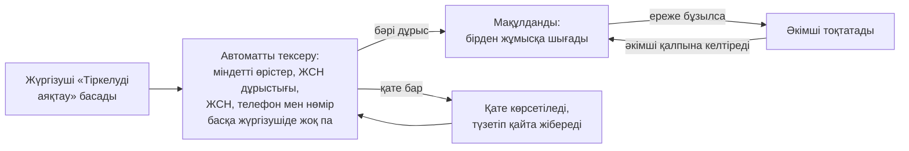
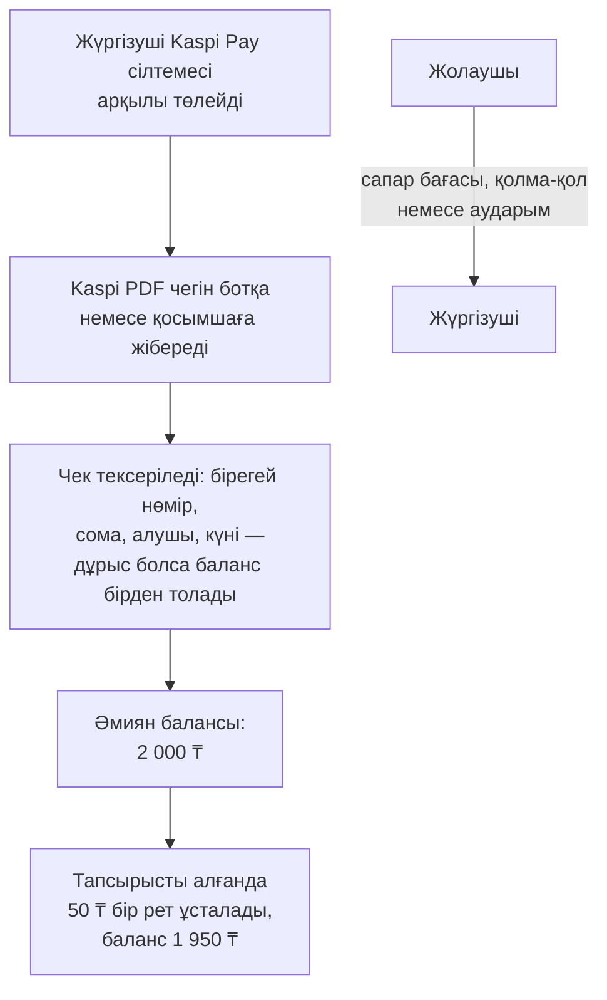
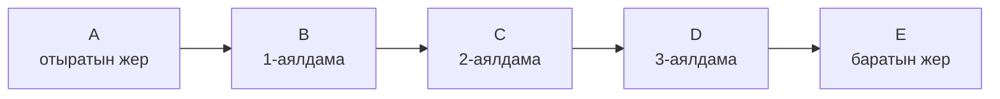
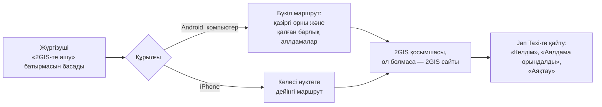

# Jan Taxi — жүйеге шолу

Jan Taxi — Telegram ішінде жұмыс істейтін такси және сәлемдеме жеткізу қызметі.
Жолаушылар мен жүргізушілер жеке қосымша орнатпайды: бәрі Telegram боттары мен
мини-қосымшалары арқылы жүреді, ал қызметті әкімшілер веб-панельден басқарады.
Бірінші қала — Ембі (Ақтөбе облысы). Тапсырыс Қазақстанның кез келген нүктесінде
қабылданады, Қазақстаннан тыс нүктелер қабылданбайды.

Қосымшалардың негізгі тілі — қазақ тілі; орыс және ағылшын тілдері де бар.

## Жалпы сызба

## Жолаушы

- Жолаушы ботты ашып, «Ашу» батырмасы арқылы мини-қосымшаға кіреді.
- Қызмет түрін таңдайды: **Такси**, **Сәлемдеме** немесе **Басқа жеткізу**.
  Сәлемдеме үшін жүктің қысқаша сипаттамасы, алушының телефон нөмірі және
  тыйым салынған заттар тізімімен келісу міндетті.
- Картадан 2–5 нүкте белгілейді: отыратын жер, ең көбі үш аралық аялдама және
  баратын жер. Картадан табылмайтын жерді (ауыл ішіндегі нысан, халық атауы,
  шағын аудан) A нүктесі үшін де, келесі нүктелер үшін де қолмен жазуға болады;
  A нүктесі картадағы белгіде қалады, сондықтан жақын жүргізушілер сол жерге
  қарай ізделеді.
- Сервер маршрутты, қашықтықты, жол уақытын және бағаны есептейді. Таксиде
  баға — таңдалған көлік класының бағасы, жолаушы оны қайта жазбайды.
  Сәлемдеме мен басқа жеткізуде жолаушы бағаны рұқсат етілген аралықтан
  таңдайды.
- Жүргізуші табылғанда жолаушы оның атын, көліктің маркасын, түсін және
  мемлекеттік нөмірін көреді, жүргізушінің жақындап келе жатқанын картадан
  бақылайды және оған қоңырау шала алады.
- Сапар ақысын жүргізушіге **тікелей** төлейді: қолма-қол немесе банк
  аударымымен. Платформа жолаушыдан ақша алмайды.
- Сапардан кейін жүргізушіні бағалай алады.

## Жүргізуші

- Жүргізуші боттан ашылатын мини-қосымшада екі бетте тіркеледі.
  1-бет: өз фотосы, аты, тегі (қаласа әкесінің аты), ЖСН (12 сан, енгізгенде
  тексеріледі) және Telegram арқылы расталған телефон нөмірі — «Келесі».
  2-бет: көлік түрі (әдепкі — Седан), маркасы мен моделі, түсі, мемлекеттік
  нөмірі, дербес деректерді өңдеуге келісім — «Тіркелуді аяқтау».
  Жеке куәліктің, жүргізуші куәлігінің сканы мен көлік фотолары сұралмайды.
- «Тіркелуді аяқтау» басылғанда жүйе деректерді автоматты тексереді (ЖСН дұрыс
  па, ЖСН, телефон және көлік нөмірі басқа жүргізушіде тіркелмеген бе), содан
  кейін жүргізуші бірден жұмысқа шығады.
- Тапсырыстар жүргізушінің GPS орнына қарай таратылады (A нүктесінен әдепкі
  5 км, күткен сайын 10 км-ге дейін). Жақын тапсырыс ботқа хабарлама болып
  келеді: бағасы, A нүктесі, аялдамалар, B нүктесі, көлік, жолаушылар саны,
  пікір және екі батырма — «✅ Тапсырысты алу» және «📱 Қосымшаны ашу».
  Мини-қосымшадағы әр тапсырыс карточкасында да жасыл «Тапсырысты алу»
  батырмасы бар — тапсырысқа кірмей-ақ алуға болады.
- Бір тапсырысты тек бір жүргізуші ала алады: екі жүргізуші бір мезетте басса
  (ботта да, қосымшада да), біріншісі ғана алады, қалғандарына «тапсырысты
  басқа жүргізуші алды» деп хабарланады және тапсырыс олардың тізімінен бірден
  жоғалады.
- Тапсырысты алған жүргізушіге жолаушының аты, Telegram сілтемесі және
  телефоны (бөліскен болса) келеді; қосымшадан қоңырау шалуға немесе
  WhatsApp-қа жазуға болады.
- Сапар кезінде: «Келдім», «Сапарды бастау», әр аялдаманы белгілеу және
  «Аяқтау». Сапар аяқталғанда «Сапар сәтті аяқталды» деп көрсетіледі.

## Жүргізушіні тексеру

Мақұлдау туралы жүргізушіге бот арқылы хабарлама келеді. Әкімші кез келген
жүргізушіні тоқтатып, қалпына келтіре алады. ЖСН әкімші панелінде жартылай
жасырылып көрсетіледі (мысалы, ********1234). Бұрын жүктелген құжат фотоларын
тек рұқсаты бар әкімшілер көреді, әр қарау аудит журналына жазылады.

## Әкімші панелі

Әкімші панелі — браузерде ашылатын жеке сайт. Онда:

- жүргізушілерді бақылау, тоқтату және қалпына келтіру;
- тапсырыстарды бақылау, қажет болса болдырмау немесе жүргізушіге тағайындау;
- дауларды шешу;
- әмиянды толтыру өтінімдерін растау немесе қабылдамау, әмияндарды түзету;
- қалалар, қызмет аймақтары, тарифтер, қолдау байланыстары және басқа
  баптаулар;
- хабарландырулар, есептер (CSV) және аудит журналы.

Әр әкімшінің рөлі бар: супер-әкімші, оператор, жүргізуші модераторы, қаржы
менеджері және аудитор. Әр рөл тек өзіне рұқсат етілген бөлімдерді көреді.

## Төлем және комиссия

- Комиссия — әкімші белгілейтін тұрақты сома (әдепкі 50 ₸, 50–100 ₸
  аралығында), тапсырысты алған сәтте бір рет ұсталады. Жолаушы бас тартса,
  комиссия автоматты қайтарылмайды; қайтаруды тек әкімші жасай алады.
- Жүргізушінің тапсырыс экрандарында және бот хабарламаларында комиссия
  көрсетілмейді — тек сапар бағасы. Ұсталған сомалар әмиян тарихында көрінеді.
- Жолаушы бүкіл соманы жүргізушіге тікелей төлейді; платформаның үлесі
  жүргізушінің алдын ала толтырылған әмиянынан ұсталады.
- Тапсырысты алу үшін әмияндағы қолжетімді қаражат комиссияға жетуі керек;
  жетпесе, жаңа тапсырыстар келмейді және бот балансты толтыруды ұсынады.
- Жаңа жүргізушіге бір рет қош келдіңіз бонусы беріледі (әдепкі 500 ₸; бір
  телефон мен бір көлік нөміріне бір рет).
- Әмиянды толтыру: жүргізуші Kaspi Pay сілтемесі арқылы төлейді де, Kaspi
  берген PDF чекті ботқа немесе қосымшаға жібереді. Бір чекті екі рет қолдану
  мүмкін емес; күмәнді чек қаржы менеджерінің тексеруіне түседі.
- Әр ақша қозғалысы өзгертуге және жоюға болмайтын журналға жазылады;
  әкімшілер әмиян мен журналдың сәйкестігін тексере алады.

## Бірнеше аялдамалы маршрут

- Бір тапсырыста 2–5 нүкте болады; әріптер картада да, тізімде де бірдей.
- Маршрут Қазақстан жолдары бойынша есептеледі (OSRM, OpenStreetMap деректері),
  баға бүкіл маршрутқа есептеледі.
- Жүргізуші аралық аялдамаларды тек ретімен белгілейді; барлық аялдама
  орындалмай тапсырысты аяқтау мүмкін емес.

## 2GIS арқылы навигация

Маршрут Jan Taxi картасында да әрдайым көрініп тұрады, сондықтан жүргізуші
келесі аялдаманы адастырмайды.

## Деректер және қауіпсіздік

- Барлық деректер, файлдар және резервтік көшірмелер Қазақстандағы серверде
  сақталады (ҚР «Дербес деректер және оларды қорғау туралы» заңы).
- Жаңа тіркелуде жеке куәлік сканы сұралмайды; бұрын жүктелген құжаттар жабық
  қоймада сақталады, тек рұқсаты бар әкімшілер көреді, әр қарау журналға
  жазылады.
- ЖСН дерекқорда сақталады, әкімші панелінде жартылай жасырылады және
  жолаушыға, ботқа, журналдарға ешқашан шықпайды.
- Жүргізуші жолаушының байланыс деректерін және алушының телефонын тек
  тапсырысты алғаннан кейін көреді (ботқа келетін тапсырыс хабарламасында
  телефон болмайды); жолаушы жүргізушінің телефонын тек тапсырыс белсенді кезде
  көреді.
- Дерекқордың және файлдардың резервтік көшірмесі күн сайын автоматты түрде
  жасалады.

## Іске қосу үшін тапсырыс берушіден не керек

- Telegram-да екі бот (жолаушы және жүргізуші) және олардың баптаулары.
- Домен және Қазақстандағы сервер.
- Kaspi Pay бизнес-шоты және төлем сілтемесі (жүргізушілер толтыруды Kaspi PDF
  чегімен растайды), қаржы менеджеріне Kaspi Pay тарихына қолжетімділік.
- Дербес деректер бойынша құжаттар: құпиялылық саясаты, келісім мәтіні,
  жауапты тұлға.
- Қолдау қызметінің байланыстары (телефон, Telegram).

Техникалық толық сипаттама: [ARCHITECTURE.md](ARCHITECTURE.md), сызбалар:
[DIAGRAMS.md](DIAGRAMS.md), орнату: [DEPLOYMENT.md](DEPLOYMENT.md).
