# Diagrams

Mermaid diagrams of how Jan Taxi works. GitHub, GitLab and most Markdown
viewers render them directly. The binding rules behind every diagram are in
[ARCHITECTURE.md](ARCHITECTURE.md) (section numbers are given with each
diagram); the HTTP details are in
[admin/backend/api/openapi.yaml](../admin/backend/api/openapi.yaml). A Kazakh
overview for the customer is in [CUSTOMER_OVERVIEW_KK.md](CUSTOMER_OVERVIEW_KK.md).

Contents:

1. [System architecture](#1-system-architecture)
2. [Deployment topology](#2-deployment-topology)
3. [Passenger booking flow](#3-passenger-booking-flow)
4. [Dispatch and atomic acceptance](#4-dispatch-and-atomic-acceptance)
5. [Order state machine](#5-order-state-machine)
6. [Driver registration and moderation](#6-driver-registration-and-moderation)
7. [Driver navigation](#7-driver-navigation)
8. [Wallet and commission flow](#8-wallet-and-commission-flow)
9. [Kaspi Pay top-up](#9-kaspi-pay-top-up)
10. [Notification outbox](#10-notification-outbox)
11. [Realtime updates](#11-realtime-updates)

## 1. System architecture

ARCHITECTURE §1. Only the API talks to PostgreSQL. The bots reach the API's
internal listener with a shared service secret; the Mini Apps and the admin panel
use the public API through Caddy.

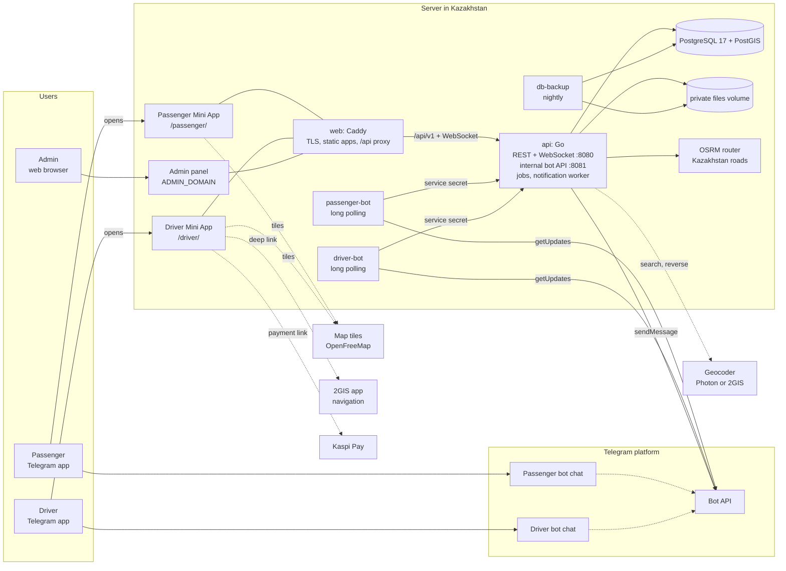

## 2. Deployment topology

`compose.yaml`. Only the `web` service publishes ports. `backend` is an internal
Docker network without internet access; `edge` connects Caddy with the API and
gives the API outbound access (Telegram, geocoder); `egress` gives the bots and
the one-shot data downloads outbound access.

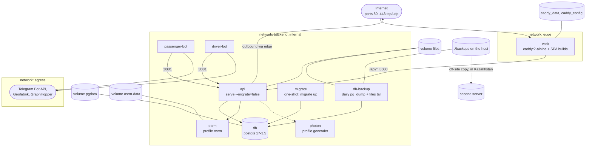

Start order enforced by Compose: `db` healthy, then `migrate` completes
successfully, then `api` healthy, then both bots. `web` starts once `api` has
started.

## 3. Passenger booking flow

ARCHITECTURE §4.1, §5, §14, §19. The server computes the route and the allowed
fares; the client only chooses inside that range.

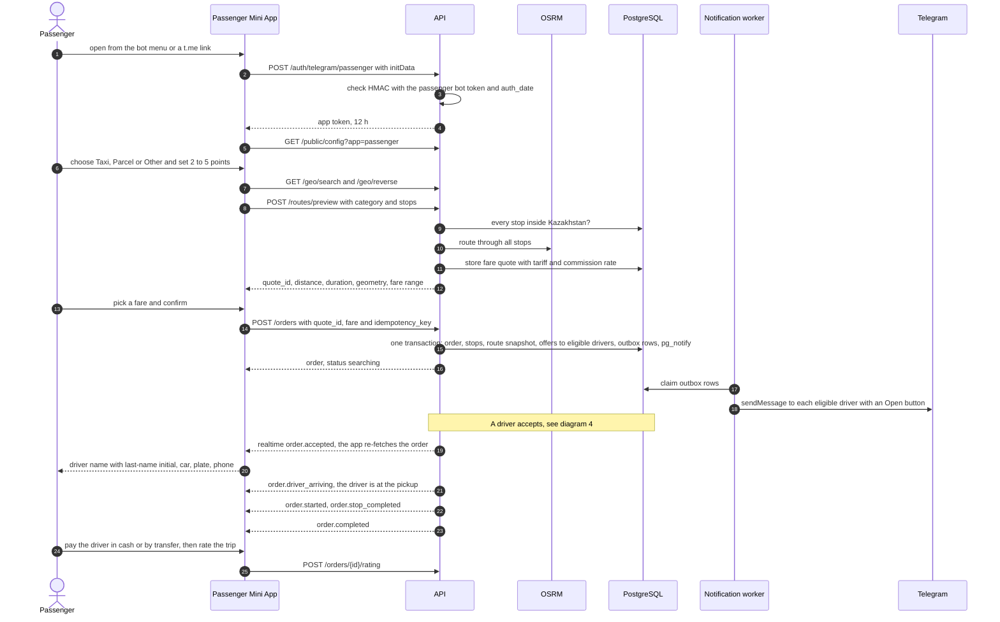

If no driver accepts within the city's `search_timeout_s` (default 900 s), the
`search_expiry` job cancels the order with reason `no_driver_found` and the
passenger is notified.

## 4. Dispatch and atomic acceptance

ARCHITECTURE §5.1, §7. Many drivers may press Accept at the same moment; the
database guarantees exactly one winner and exactly one commission reservation.

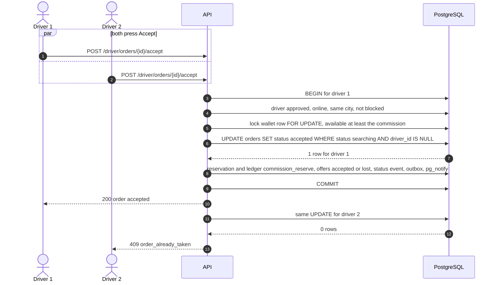

Other refusals: `402 insufficient_balance` when the wallet cannot cover the
commission (with a top-up hint), `409 driver_has_active_order` from the partial
unique index `orders_one_active_per_driver`.

Eligibility (computed live, so drivers who come online later still see open
orders): profile `approved`, online, user not blocked, same city as the order,
no active order, `available >= commission`, and, if the city requires it, a
fresh location within `dispatch_radius_m` of the pickup.

## 5. Order state machine

ARCHITECTURE §5. Every transition is a conditional `UPDATE ... WHERE status =
expected` plus a status event, notifications and a realtime event in one
transaction. Anything not drawn here is `409 invalid_transition`.

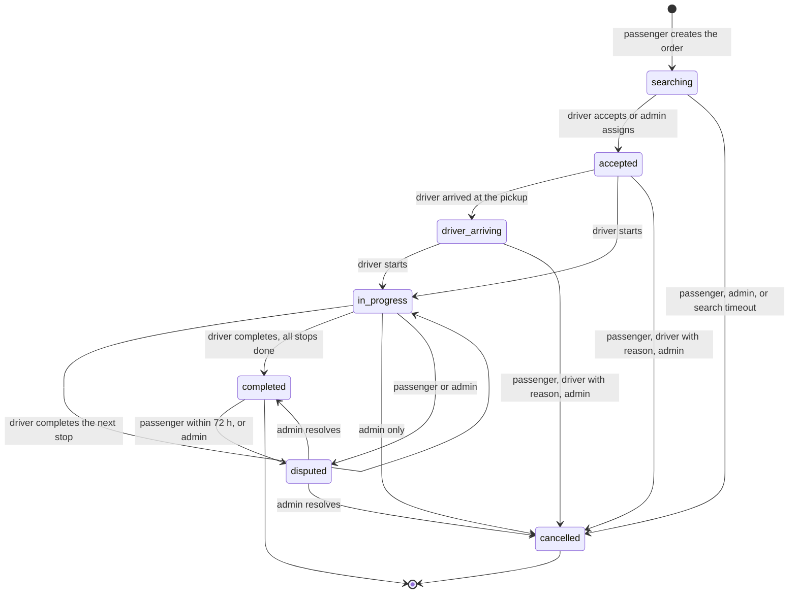

`driver_arriving` means the driver has arrived at the pickup and is waiting.
Money attached to the transitions:

| Transition | Wallet effect |
|---|---|
| `searching → accepted` | reserve the commission |
| `accepted / driver_arriving / in_progress → cancelled` | release the reservation |
| `in_progress → completed` | charge the commission once |
| `disputed → cancelled` after completion, with refund | refund the commission |

## 6. Driver registration and moderation

ARCHITECTURE §11, §19. The phone number is accepted only when Telegram itself
delivers the driver's own contact to the driver bot.

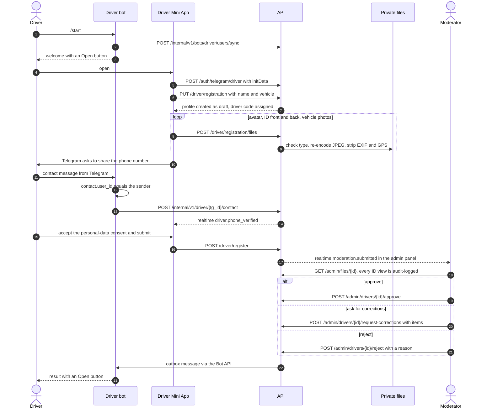

Driver profile statuses:

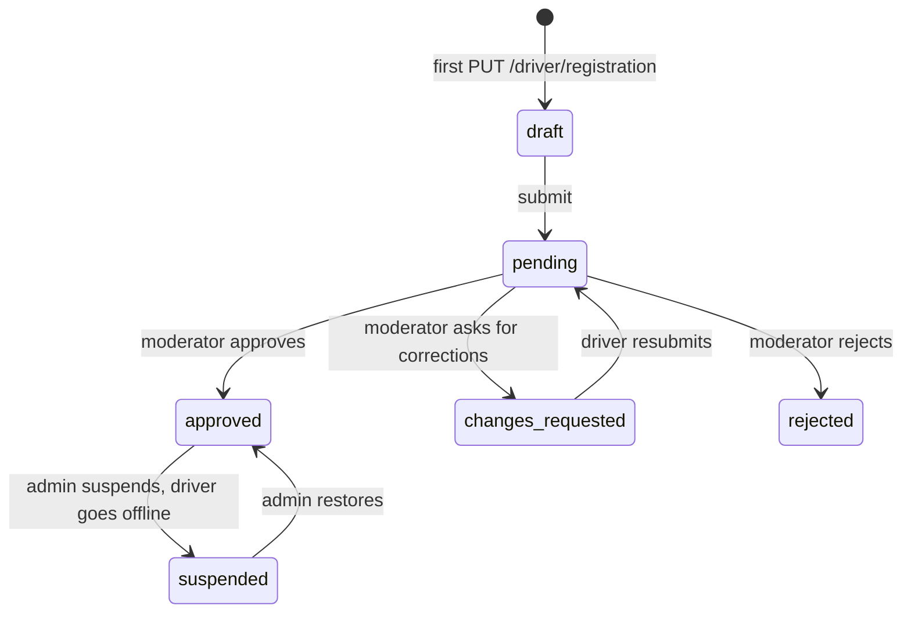

Only `approved` drivers can go online (`PATCH /driver/availability`), and only
while their available balance is at least `driver.min_online_balance`.

## 7. Driver navigation

The driver Mini App opens 2GIS with https links through Telegram's `openLink`
(custom schemes are blocked inside Telegram):
`https://2gis.ru/directions/tab/car/points/<from>|<via...>|<to>` with points as
`lon,lat`; an empty `<from>` starts at the phone's current location. The full
route always stays visible on the map inside Jan Taxi.

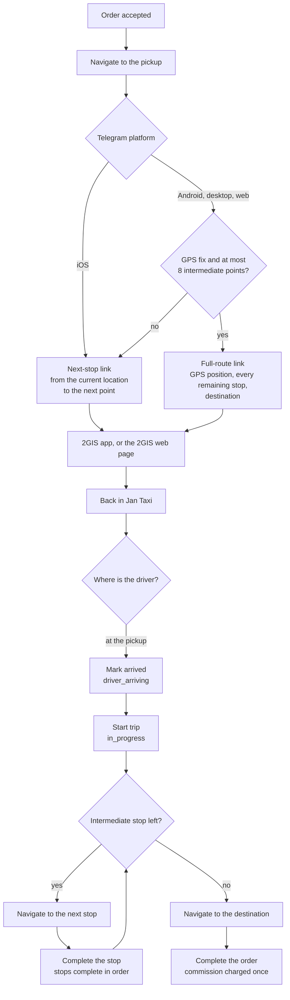

The 2GIS base URL comes from the setting `navigation.twogis_base_url` (only
`2gis.ru`, `2gis.kz` and `2gis.com` over https are accepted).

## 8. Wallet and commission flow

ARCHITECTURE §6. Money is integer tenge. Commission =
`(fare × commission_bps + 5000) / 10000`, rounded half up, `commission_bps`
default 1000 (10%), snapshotted on the order. Every change writes the wallet row
and an append-only ledger row with a unique idempotency key in the same
transaction.

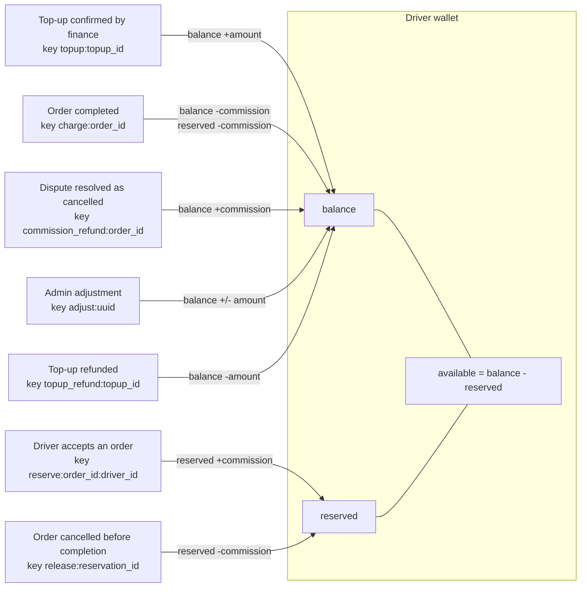

Worked example with a fare of 1,000 ₸ and 10% commission:

| Step | balance | reserved | available |
|---|---|---|---|
| top-up of 2,000 ₸ confirmed | 2,000 | 0 | 2,000 |
| order accepted, 100 ₸ reserved | 2,000 | 100 | 1,900 |
| order completed, 100 ₸ charged | 1,900 | 0 | 1,900 |

The passenger pays the full 1,000 ₸ to the driver directly (cash or bank
transfer); the platform never receives passenger money. A repeated request with
the same idempotency key returns the first result and never charges twice. The
database keeps `balance >= 0`, `reserved >= 0` and `reserved <= balance`; admins
see a reconciliation that compares every wallet with the sum of its ledger rows.

## 9. Kaspi Pay top-up

ARCHITECTURE §6.1. There is no automatic payment confirmation: a finance admin
credits the wallet only after finding the payment in the merchant's Kaspi Pay
records.

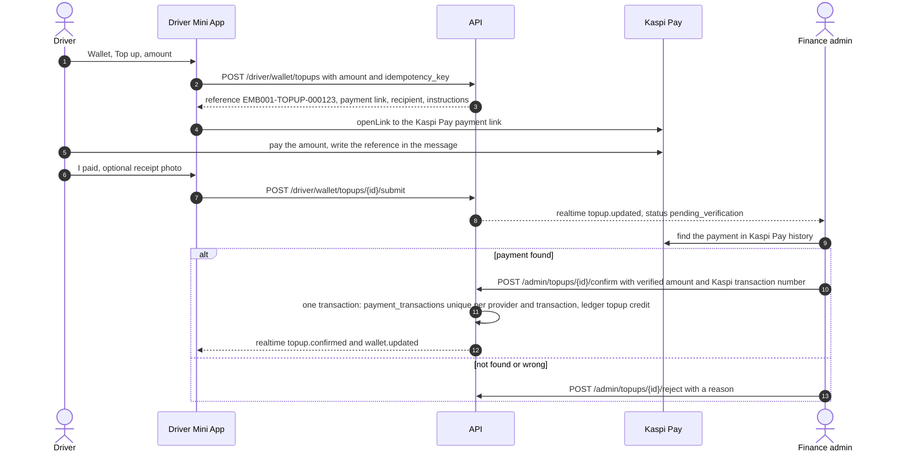

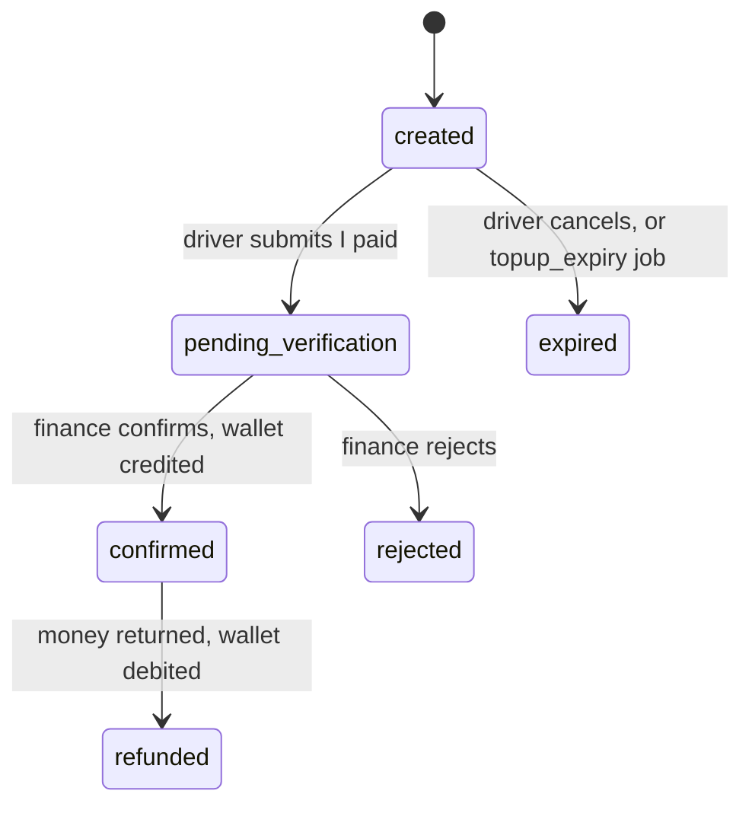

A Kaspi transaction number can be used only once (`UNIQUE(provider,
provider_transaction_id)`), so one real payment can never credit two top-ups.

## 10. Notification outbox

ARCHITECTURE §8. Telegram messages are rows written in the same transaction as
the business change, so a rolled-back change never sends a message and a
committed one is never lost.

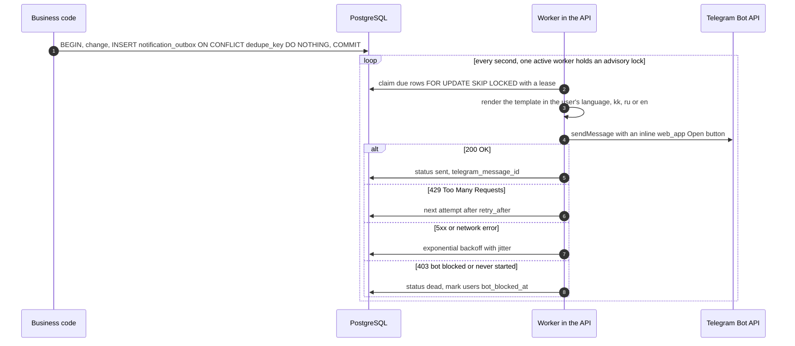

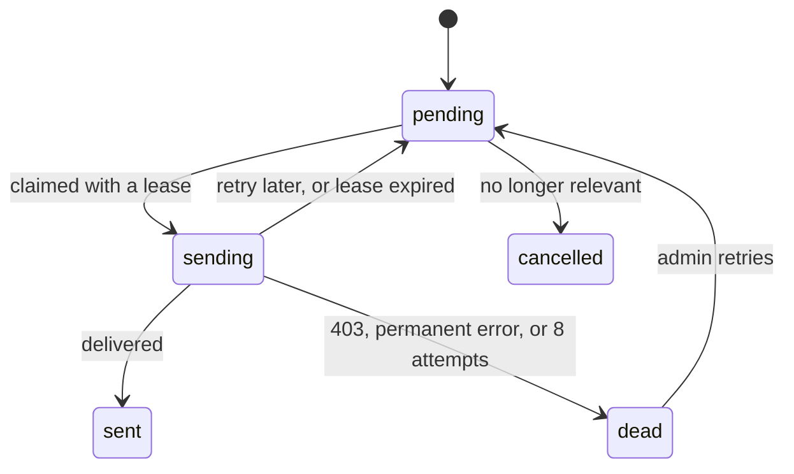

Sending is limited to 25 messages per second per bot and one message per second
per chat. Admins see and retry rows under Notifications in the admin panel.

## 11. Realtime updates

ARCHITECTURE §9. Events are published with `pg_notify` inside the business
transaction, so clients hear about a change only after it is committed. Events
are hints; clients re-fetch the authoritative state over REST.

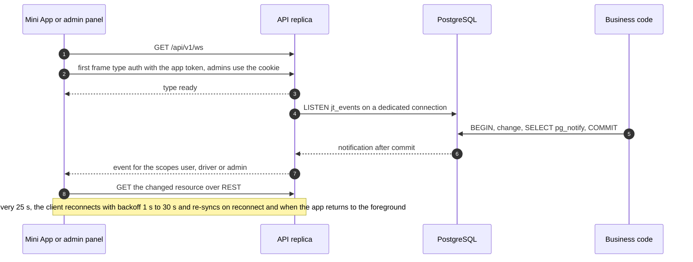
